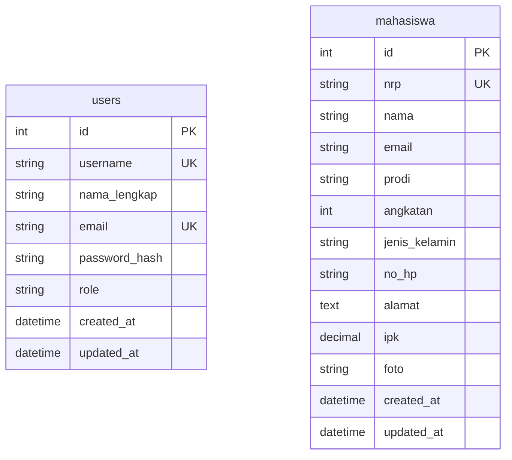
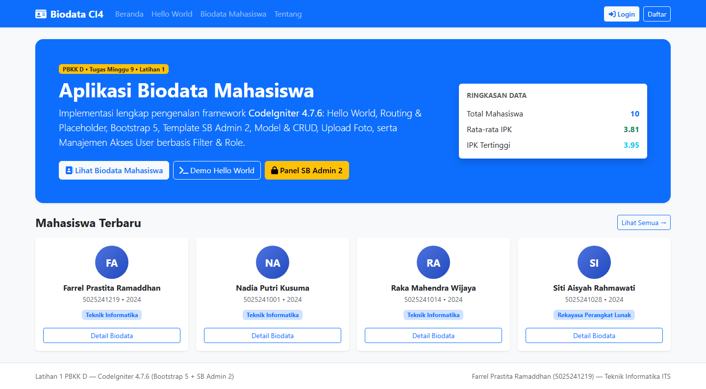
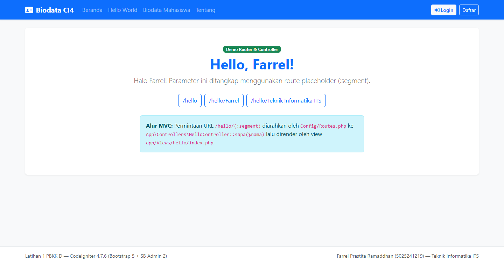
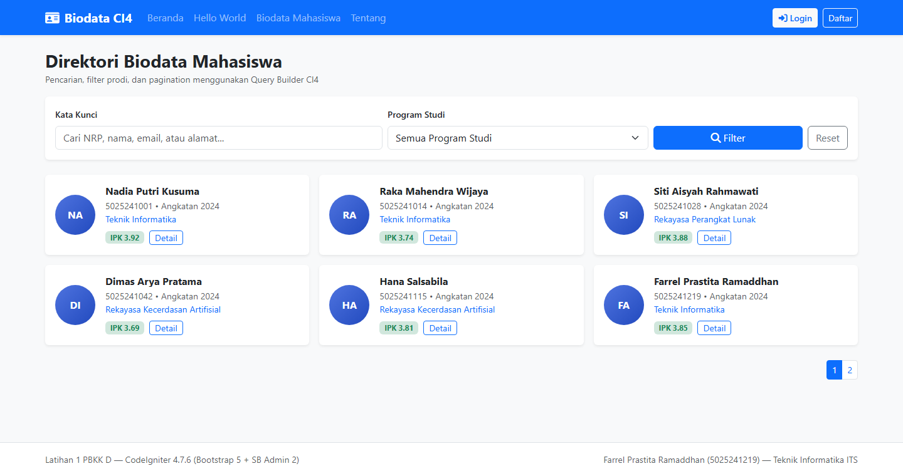
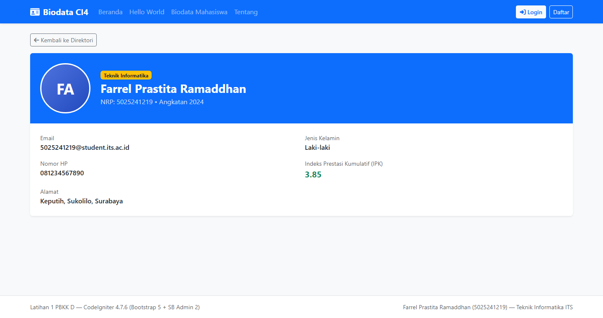
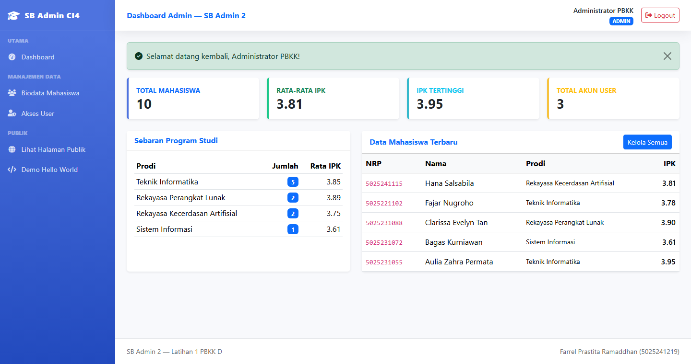
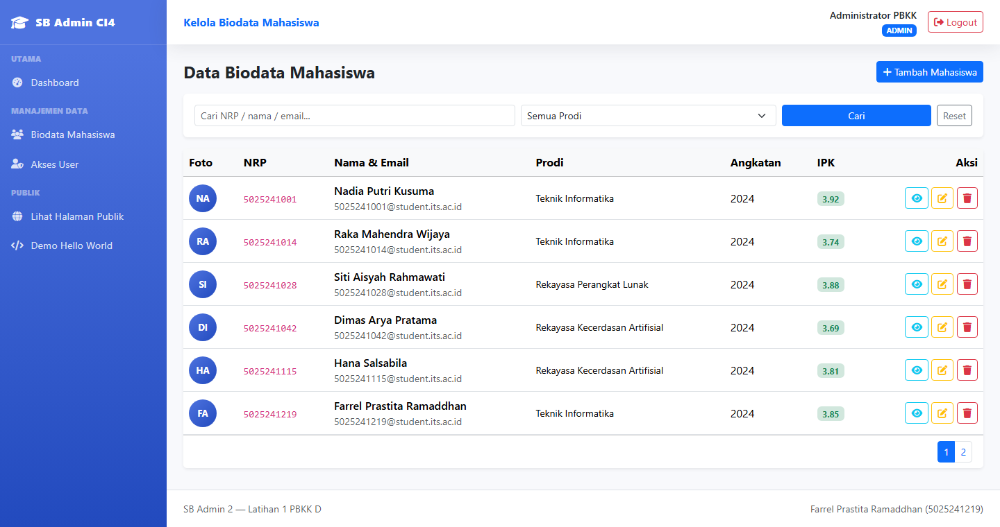

# Latihan 1 — Aplikasi Biodata Mahasiswa (CodeIgniter 4)

- **Identitas**: Farrel Prastita Ramaddhan — NRP `5025241219` (PBKK D, Teknik Informatika ITS)
- **Port Default**: `8080`
- **Framework**: CodeIgniter `4.7.6` (PHP 8.2+, Bootstrap 5 + SB Admin 2)

---

## Ringkasan Materi yang Diimplementasikan

Aplikasi ini mencakup seluruh 7 pokok bahasan **Latihan 1** pada materi [PBKK-2 Pengenalan Framework CodeIgniter](https://fajarbaskoro.blogspot.com/2019/02/pbkk-2-pengenalan-framework-code-igniter.html):

1. **Instalasi, Konfigurasi & Hello World CI4**
   - Konfigurasi `.env`, `Config\App` (`baseURL`, `indexPage = ''`, timezone `Asia/Jakarta`), `Config\Database` (SQLite3 default & opsi MySQLi), serta cookie session/CSRF terisolasi (`ci_latihan1_session`).
   - Halaman Hello World di `GET /hello` dan `GET /hello/(:segment)`.
2. **Router, Placeholder, Route Group & Controller**
   - Placeholder `(:segment)` pada `/hello/(:segment)` dan `/biodata/(:segment)`.
   - Route group `/admin` dengan namespace `App\Controllers\Admin` serta filter berlapis `['auth', 'role:admin']`.
3. **Bootstrap 5 untuk Halaman Publik**
   - Layout `app/Views/layouts/public.php` dengan navbar responsif, kartu biodata, pencarian kata kunci, filter prodi, dan pagination kustom `app/Views/pager/bootstrap_pager.php`.
4. **Template SB Admin 2 (Layout, Section, Partial View)**
   - Layout `app/Views/layouts/admin.php` yang memisahkan komponen menjadi partial view: `partials/admin_sidebar.php`, `partials/admin_topbar.php`, dan `partials/flash.php`.
5. **Model, Validasi, Query Builder, CRUD & Pagination**
   - `App\Models\MahasiswaModel` mengelola validasi data (NRP unik, email valid, IPK `0.00–4.00`), pencarian dengan `groupStart()->like()->orLike()`, agregasi statistik rata-rata & sebaran per prodi, serta pagination.
   - CRUD penuh tersedia pada `App\Controllers\Admin\MahasiswaController`.
6. **Penanganan File Upload**
   - Upload foto profil mahasiswa (format `jpg`, `jpeg`, `png`, `webp`, ukuran maksimal 2 MB) ke `public/uploads/foto/` dengan nama file acak (`$file->getRandomName()`) serta penghapusan otomatis foto lama saat data diperbarui atau dihapus.
7. **Mengatur Akses User (Authentication & Authorization)**
   - Registrasi, login (`password_hash` / `password_verify`), logout, dan proteksi CSRF global.
   - `AuthFilter` memastikan pengguna sudah login; `RoleFilter` membatasi akses `/admin/*` hanya bagi role `admin` dan menyediakan halaman manajemen toggle role user di `/admin/users`.

---

## Skema Database



---

## Daftar Route Utama

| Method | URI | Controller::Method | Filter |
| :--- | :--- | :--- | :--- |
| `GET` | `/` | `Home::index` | `csrf` |
| `GET` | `/tentang` | `Home::about` | `csrf` |
| `GET` | `/hello` & `/hello/(:segment)` | `HelloController::index` / `sapa` | `csrf` |
| `GET` | `/biodata` & `/biodata/(:segment)` | `BiodataController::index` / `detail` | `csrf` |
| `GET/POST` | `/login`, `/register` | `AuthController` | `csrf` |
| `POST` | `/logout` | `AuthController::logout` | `csrf`, `auth` |
| `GET` | `/profil` | `ProfilController::index` | `csrf`, `auth` |
| `GET` | `/admin` | `Admin\DashboardController::index` | `csrf`, `auth`, `role:admin` |
| `GET/POST` | `/admin/mahasiswa/*` | `Admin\MahasiswaController` | `csrf`, `auth`, `role:admin` |
| `GET/POST` | `/admin/users/*` | `Admin\UserController` | `csrf`, `auth`, `role:admin` |

---

## Screenshot Hasil Aplikasi

### 1. Halaman Beranda Publik (Bootstrap 5)


### 2. Demo Hello World & Route Placeholder (`/hello/Farrel`)


### 3. Direktori Biodata Publik (Pencarian, Filter Prodi & Pagination)


### 4. Detail Biodata Mahasiswa (`/biodata/5025241219`)


### 5. Panel Admin — Dashboard SB Admin 2 (`/admin`)


### 6. Panel Admin — CRUD Biodata & Upload Foto (`/admin/mahasiswa`)


---

## Cara Menjalankan

```bash
cd Latihan1
composer install
cp .env.example .env
php spark migrate
php spark db:seed DatabaseSeeder
php spark serve --port 8080
```

Akun demo seeder:
- **Admin**: `admin` / `admin123` (akses penuh Panel SB Admin 2 & CRUD)
- **User**: `farrel` / `mhs123` (akses publik & profil, diblokir masuk `/admin`)
