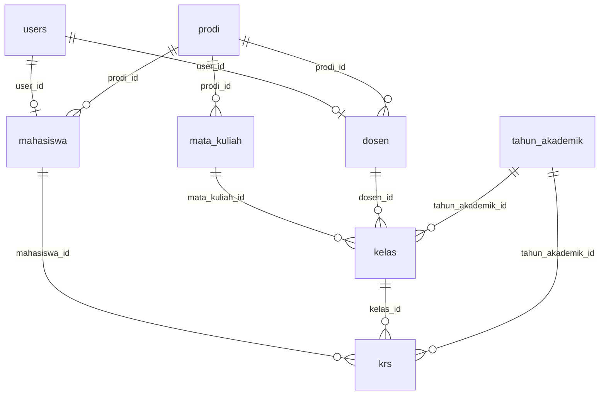

# Latihan 2a — Sistem Informasi Akademik (SIAKAD)

- **Identitas**: Farrel Prastita Ramaddhan — NRP `5025241219` (PBKK D, Teknik Informatika ITS)
- **Port Default**: `http://localhost:8081`
- **Framework**: CodeIgniter `4.7.6` (PHP 8.2+, Template SB Admin 2)

---

## Fitur Utama (3 Role)

### 1. Administrator (`/admin`)
- Dashboard ringkasan jumlah prodi, dosen, mahasiswa, mata kuliah, KRS, dan daftar kelas semester aktif.
- Master Data lengkap dalam route group bersarang `/admin/master/*`:
  - **Program Studi** (`/admin/master/prodi`)
  - **Tahun Akademik** (`/admin/master/tahun-akademik`) beserta aktivasi semester aktif dalam transaksi database.
  - **Data Dosen** (`/admin/master/dosen`) — pembuatan data dosen sekaligus akun login dalam satu transaksi atomik.
  - **Data Mahasiswa** (`/admin/master/mahasiswa`) — pencarian & pembuatan akun login mahasiswa atomik.
  - **Mata Kuliah** (`/admin/master/matakuliah`)
  - **Kelas & Jadwal** (`/admin/master/kelas`) — menghitung jumlah peserta via `LEFT JOIN` & `GROUP BY`.

### 2. Dosen (`/dosen`)
- Dashboard daftar kelas yang diampu pada semester aktif dan total mahasiswa.
- Daftar seluruh kelas (`/dosen/kelas`) & **Input Nilai Mahasiswa** (`/dosen/kelas/{id}/nilai`).
- Penyimpanan nilai angka (`0–100`) dilakukan di dalam transaksi database dan **otomatis dikonversi** ke huruf mutu (`A`, `AB`, `B`, `BC`, `C`, `D`, `E`), bobot (`4.00–0.00`), serta status kelulusan menggunakan `Config\Akademik` & `akademik_helper`.

### 3. Mahasiswa (`/mahasiswa`)
- Dashboard akademik menampilkan **IPK kumulatif**, predikat kelulusan, SKS lulus, SKS semester aktif, dan jadwal KRS berjalan.
- **Pengisian KRS** (`/mahasiswa/krs`):
  - Validasi batas maksimal SKS per semester (`Config\Akademik::$maxSksPerSemester = 24`).
  - Validasi duplikasi mata kuliah pada semester yang sama.
  - Validasi kapasitas kuota kelas dalam transaksi database.
  - Pembatalan mata kuliah (dicegah apabila dosen sudah menginput nilai).
- **Kartu Hasil Studi / KHS** (`/mahasiswa/khs`) dengan filter semester, perhitungan IPS semester dan IPK kumulatif melalui JOIN & agregasi Query Builder.
- **Transkrip Nilai Kumulatif** (`/mahasiswa/transkrip`).

---

## Konsep Arsitektur yang Diterapkan

- **Abstract Controller (Pewarisan)**:
  - `App\Controllers\AbstractRoleController` menjadi kelas induk abstrak yang otomatis memuat `akademik_helper`, `Config\Akademik`, dan data `tahunAktif`.
  - Diwarisi oleh `Admin\BaseAdminController`, `Dosen\BaseDosenController` (auto-load profil dosen), dan `Mahasiswa\BaseMahasiswaController` (auto-load profil mahasiswa).
- **Custom Config & Helper**:
  - `app/Config/Akademik.php`: batas maksimal SKS dan skala konversi nilai ITS (`A >= 86`, `AB >= 76`, dst.).
  - `app/Helpers/akademik_helper.php`: `konversi_nilai()`, `predikat_ipk()`, `badge_nilai()`, `nama_dosen_lengkap()`.
- **Route Group Bersarang & Filter 3 Role**:
  - `admin` (`role:admin`) dengan sub-group `master`, `dosen` (`role:dosen`), dan `mahasiswa` (`role:mahasiswa`).

---

## Skema Database (8 Tabel dengan Foreign Key)



---

## Cara Menjalankan

```bash
cd Latihan2/SistemAkademik
composer install
cp .env.example .env
php spark migrate
php spark db:seed SiakadSeeder
php spark serve --port 8081
```

Buka `http://localhost:8081`:
- **Admin**: `admin` / `admin123`
- **Dosen**: `dosen1` / `dosen123` (Dr. Fajar Baskoro, S.Kom., M.T.)
- **Mahasiswa**: `farrel` / `mhs123` (Farrel Prastita Ramaddhan — `5025241219`)
