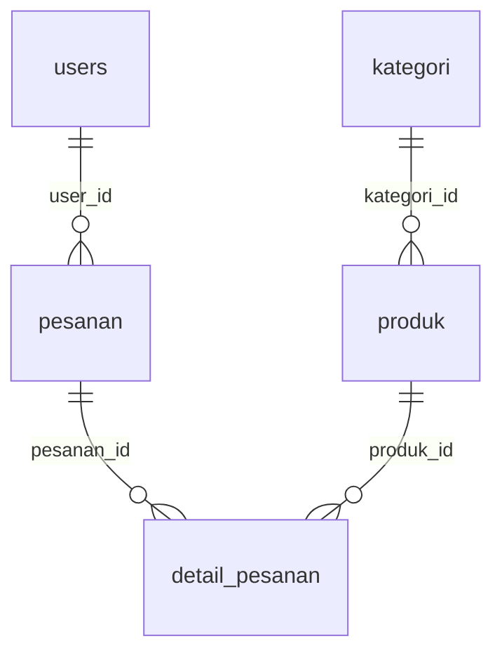

# Latihan 2b — Aplikasi Toko Online (TokoKita)

- **Identitas**: Farrel Prastita Ramaddhan — NRP `5025241219` (PBKK D, Teknik Informatika ITS)
- **Port Default**: `http://localhost:8082`
- **Framework**: CodeIgniter `4.7.6` (PHP 8.2+, Bootstrap 5 Storefront + SB Admin 2 Panel Admin)

---

## Fitur Utama

### 1. Storefront Pelanggan (`/`)
- **Katalog Produk** dengan pencarian kata kunci, filter kategori, filter harga minimal/maksimal, pengurutan (`terbaru`, `terlaris`, `termurah`, `termahal`), **subquery `total_terjual`**, dan pagination Bootstrap 5.
- **Detail Produk** (`/produk/{slug}`) menampilkan informasi stok aktual, total unit terjual, dan rekomendasi produk sejenis.
- **Keranjang Belanja** (`/keranjang`) dikelola melalui `App\Libraries\CartLibrary` berbasis session dengan perhitungan otomatis subtotal, gratis ongkir (minimal belanja Rp 250.000), dan grand total.
- **Auth Filter + Redirect ke URL Tujuan**: pelanggan yang belum login dapat mengisi keranjang terlebih dahulu; saat menekan `/checkout`, `AuthFilter` menyimpan URL tujuan di session sehingga setelah login langsung diarahkan kembali ke `/checkout`.
- **Checkout dengan Transaksi Database & Rollback Stok**:
  - Diproses oleh `App\Services\CheckoutService::prosesCheckout()` di dalam `transBegin() / transCommit() / transRollback()`.
  - Jika salah satu produk di keranjang tidak mencukupi stoknya, sistem melempar **Custom Exception** `InsufficientStockException` dan melakukan **rollback penuh** sehingga stok produk lain yang sempat diproses tetap utuh.
- **Riwayat Pesanan & Invoice** (`/pesanan` dan `/pesanan/{kode_invoice}`).

### 2. Panel Administrator (`/admin`, SB Admin 2)
- **Dashboard Statistik**: total omzet, total pesanan, pesanan pending, jumlah produk/kategori/pelanggan, serta peringatan stok menipis (`<= 5`).
- **CRUD Kategori** (`/admin/kategori`) dengan penghitungan jumlah produk per kategori.
- **CRUD Produk & Upload Gambar** (`/admin/produk`) dengan validasi gambar (`jpg/jpeg/png/webp`, maks 2 MB) dan pembersihan otomatis file lama.
- **Manajemen Status Pesanan** (`/admin/pesanan`): perubahan status (`pending` → `diproses` → `dikirim` → `selesai` / `dibatalkan`). Jika dibatalkan, `CheckoutService::ubahStatusPesanan()` otomatis mengembalikan stok produk di dalam transaksi database.

---

## Konsep Lanjutan yang Diimplementasikan

| Komponen | Lokasi File | Peran |
| :--- | :--- | :--- |
| **Custom Config** | `app/Config/Toko.php` | Nama toko, ongkir flat, batas gratis ongkir, metode pembayaran, daftar status pesanan |
| **Custom Helper** | `app/Helpers/toko_helper.php` | `format_rupiah()`, `badge_status_pesanan()`, `label_status_pesanan()`, `slugify_text()` |
| **Custom Library** | `app/Libraries/CartLibrary.php` | Manajemen item keranjang belanja berbasis session & perhitungan total/ongkir |
| **Custom Service** | `app/Services/CheckoutService.php` & `app/Config/Services.php` | Orkestrasi checkout atomik, pengurangan & pengembalian stok dalam transaksi DB |
| **Custom Exception** | `app/Exceptions/InsufficientStockException.php`, `EmptyCartException.php` | Penanganan kegagalan stok & keranjang kosong yang memicu rollback transaksi |

---

## Skema Database (5 Tabel dengan Foreign Key)



---

## Cara Menjalankan

```bash
cd Latihan2/TokoOnline
composer install
cp .env.example .env
php spark migrate
php spark db:seed TokoSeeder
php spark serve --port 8082
```

Buka `http://localhost:8082`:
- **Admin Toko**: `admin` / `admin123` (Panel SB Admin 2 di `/admin`)
- **Customer**: `farrel` / `user123` (Storefront, Keranjang, Checkout & Invoice)
