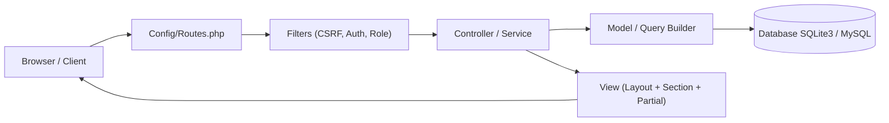

# Tugas Minggu 9: Pengenalan Framework CodeIgniter

- **Mata Kuliah**: Pemrograman Berbasis Kerangka Kerja (PBKK) — Kelas D
- **Nama**: Farrel Prastita Ramaddhan
- **NRP / Angkatan**: 5025241219 / 2024
- **Program Studi**: Teknik Informatika, Institut Teknologi Sepuluh Nopember (ITS)
- **Framework**: CodeIgniter **4.7.6** (PHP 8.2+, pola arsitektur MVC)
- **Referensi Materi**:
  - [PBKK-2 Pengenalan Framework CodeIgniter — Fajar Baskoro](https://fajarbaskoro.blogspot.com/2019/02/pbkk-2-pengenalan-framework-code-igniter.html)
  - [Playlist Tutorial Sistem Informasi Akademik dengan CodeIgniter](https://www.youtube.com/watch?v=VaA_dmqs5so&list=PLce3Eyp7oY9_hXzGACf988F1ojvQlYmB0)
  - [Playlist Tutorial Membuat Toko Online dengan CodeIgniter](https://www.youtube.com/watch?v=3v5fOQWUiuA&list=PLce3Eyp7oY98Kfzlhi25W1fEhcd36SXCY)

---

## Daftar Latihan

Ketiga aplikasi adalah proyek **CodeIgniter 4** yang berdiri sendiri (masing-masing memiliki `composer.json`, `vendor/`, database, session cookie, CSRF cookie, dan port sendiri), sehingga dapat dijalankan secara bersamaan tanpa konflik.

| Latihan | Folder | Aplikasi | Port | Laporan |
| :--- | :--- | :--- | :---: | :--- |
| **Latihan 1** | [`Latihan1/`](Latihan1/) | **Biodata Mahasiswa**: instalasi & konfigurasi CI4, Hello World, router & controller, Bootstrap 5, template SB Admin 2, Model & CRUD, upload foto, manajemen akses user | `8080` | [README Latihan 1](Latihan1/README.md) |
| **Latihan 2a** | [`Latihan2/SistemAkademik/`](Latihan2/SistemAkademik/) | **Sistem Informasi Akademik (SIAKAD)**: 3 role (`admin`, `dosen`, `mahasiswa`), master data akademik, KRS dengan validasi batas SKS & kuota, input nilai otomatis, KHS, transkrip & IPK | `8081` | [README SIAKAD](Latihan2/SistemAkademik/README.md) |
| **Latihan 2b** | [`Latihan2/TokoOnline/`](Latihan2/TokoOnline/) | **Toko Online (TokoKita)**: katalog produk dengan filter/sorting/subquery terlaris, keranjang belanja, checkout dengan transaksi & rollback stok, riwayat pesanan & invoice, panel admin SB Admin 2 | `8082` | [README TokoKita](Latihan2/TokoOnline/README.md) |

---

## Struktur Direktori

```text
TugasMinggu9/
├── .vs/
│   └── tasks.vs.json              # Task Visual Studio untuk menjalankan ketiga aplikasi
├── run-all.ps1                    # Skrip PowerShell menjalankan ketiga server bersamaan
├── README.md                      # Laporan utama (file ini)
├── Latihan1/                      # Aplikasi Biodata Mahasiswa (Port 8080)
│   ├── app/
│   ├── public/
│   ├── writable/
│   └── README.md
└── Latihan2/
    ├── SistemAkademik/            # Aplikasi SIAKAD 3-Role (Port 8081)
    │   ├── app/
    │   ├── public/
    │   ├── writable/
    │   └── README.md
    └── TokoOnline/                # Aplikasi Toko Online TokoKita (Port 8082)
        ├── app/
        ├── public/
        ├── writable/
        └── README.md
```

---

## Konsep Framework CodeIgniter 4 yang Dipelajari

| Konsep | Latihan 1 (Biodata) | Latihan 2a (SIAKAD) | Latihan 2b (Toko Online) |
| :--- | :---: | :---: | :---: |
| **MVC (Model, View, Controller)** | ✓ | ✓ | ✓ |
| **Routing, placeholder, route group** | ✓ | ✓ (bersarang + namespace) | ✓ |
| **Filter (auth & role)** | ✓ | ✓ (3 role: admin/dosen/mahasiswa) | ✓ (+ redirect ke URL tujuan) |
| **Model: validasi, Query Builder, pagination** | ✓ | ✓ (JOIN, agregasi IP/IPK) | ✓ (filter, sorting, subquery) |
| **Migration & Seeder** | ✓ | ✓ (foreign key 8 tabel) | ✓ (foreign key 5 tabel) |
| **Layout, section, partial view** | ✓ | ✓ | ✓ |
| **Bootstrap 5 / SB Admin 2** | ✓ / ✓ | – / ✓ | ✓ / ✓ |
| **Upload file (validasi MIME & ukuran)** | ✓ (foto mahasiswa) | – | ✓ (gambar produk) |
| **Transaksi database** | – | ✓ (input nilai, KRS, TA aktif) | ✓ (checkout & rollback stok) |
| **Custom Config & Helper** | – | ✓ (`Config\Akademik`, `akademik_helper`) | ✓ (`Config\Toko`, `toko_helper`) |
| **Custom Service & Library** | – | – | ✓ (`CartLibrary`, `CheckoutService`) |
| **Abstract Controller (pewarisan)** | – | ✓ (`AbstractRoleController`) | – |
| **Custom Exception** | – | – | ✓ (`InsufficientStockException`, `EmptyCartException`) |
| **Keamanan CSRF & Password Hashing** | ✓ | ✓ | ✓ |

---

## Arsitektur Umum MVC CodeIgniter 4



---

## Prasyarat & Cara Menjalankan

### Prasyarat
- **PHP 8.2+** dengan ekstensi `intl`, `mbstring`, `sqlite3`, `pdo_sqlite`, `fileinfo` (dan `mysqli` jika ingin menggunakan MySQL).
- **Composer 2.x** untuk menginstal dependensi `vendor/`.

### 1. Instalasi Dependensi & Migrasi Database

Secara default ketiga proyek dikonfigurasi menggunakan **SQLite3** (file `.db` disimpan mandiri di folder `writable/` masing-masing) sehingga langsung bisa dijalankan tanpa mengatur password MySQL. Konfigurasi alternatif **MySQLi** tetap tersedia di `.env.example` tiap aplikasi.

```bash
# Latihan 1 — Biodata Mahasiswa (Port 8080)
cd Latihan1
composer install
cp .env.example .env
php spark migrate
php spark db:seed DatabaseSeeder
php spark serve --port 8080
```

```bash
# Latihan 2a — Sistem Informasi Akademik / SIAKAD (Port 8081)
cd Latihan2/SistemAkademik
composer install
cp .env.example .env
php spark migrate
php spark db:seed SiakadSeeder
php spark serve --port 8081
```

```bash
# Latihan 2b — Toko Online / TokoKita (Port 8082)
cd Latihan2/TokoOnline
composer install
cp .env.example .env
php spark migrate
php spark db:seed TokoSeeder
php spark serve --port 8082
```

Atau jalankan ketiganya sekaligus di Windows melalui PowerShell:

```powershell
.\run-all.ps1
```

### 2. Ringkasan Akun Demo

| Aplikasi | URL | Role | Username | Password |
| :--- | :--- | :--- | :--- | :--- |
| **Latihan 1 (Biodata)** | `http://localhost:8080` | Admin | `admin` | `admin123` |
| **Latihan 1 (Biodata)** | `http://localhost:8080` | User | `farrel` | `mhs123` |
| **Latihan 2a (SIAKAD)** | `http://localhost:8081` | Admin | `admin` | `admin123` |
| **Latihan 2a (SIAKAD)** | `http://localhost:8081` | Dosen | `dosen1` | `dosen123` |
| **Latihan 2a (SIAKAD)** | `http://localhost:8081` | Mahasiswa | `farrel` | `mhs123` |
| **Latihan 2b (TokoKita)** | `http://localhost:8082` | Admin | `admin` | `admin123` |
| **Latihan 2b (TokoKita)** | `http://localhost:8082` | Customer | `farrel` | `user123` |

